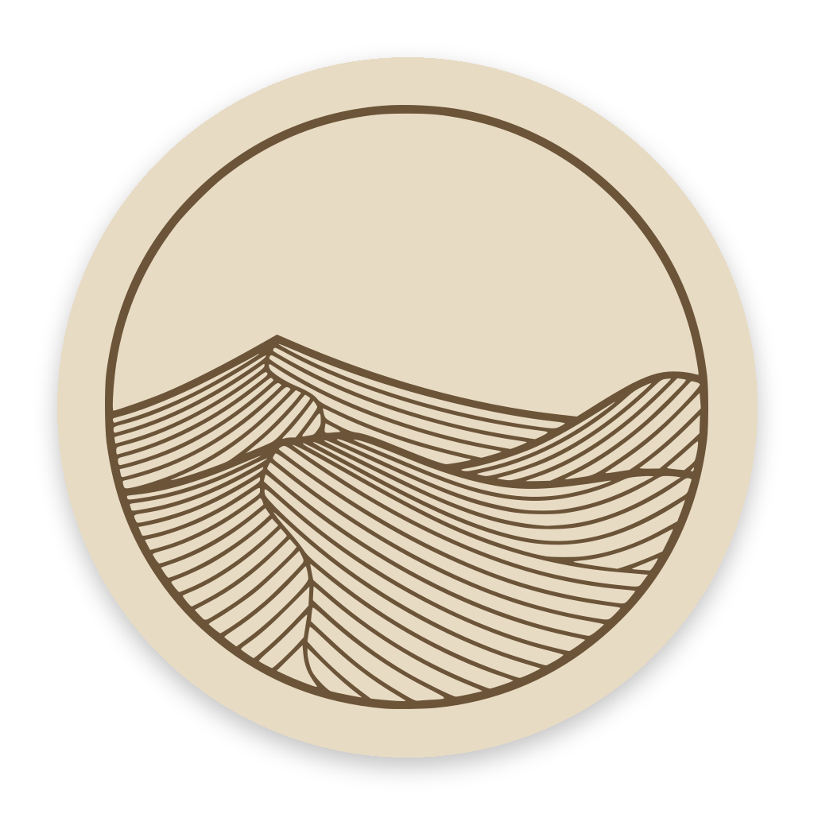

<p align="center"></p>

# Dune Weaver Viewer

Thumbnails, previews and playback for Dune Weaver `.thr` sand patterns, on Mac and Windows.

## Download

Get the latest build from [Releases](https://github.com/tuanchris/dune-weaver-viewer/releases/latest).

- **Windows 10/11 (x64):** run `DuneWeaverViewer-<version>-windows-x64.exe`. It installs for your user, with no admin rights needed. The installer isn't code-signed, so SmartScreen may warn: choose *More info → Run anyway*. The app needs the Microsoft Edge WebView2 Runtime, which Windows 11 includes. On Windows 10, get it from [Microsoft](https://go.microsoft.com/fwlink/p/?LinkId=2124703) if the app asks.
- **macOS 14+:** unzip `DuneWeaverViewer-<version>-mac.zip` and move **Dune Weaver Viewer** to Applications. It isn't notarized, so clear the download flag once before the first launch:
  ```sh
  xattr -dr com.apple.quarantine "/Applications/Dune Weaver Viewer.app"
  ```

## What it does

| | Mac | Windows |
| --- | --- | --- |
| Pattern thumbnails in the file browser | Finder (Quick Look thumbnail extension) | Explorer (thumbnail provider) |
| Quick preview with replay | Quick Look, press space | none yet |
| Double-click to play | app, **Fast** and **Sand** modes | app, **Fast** and **Sand** modes |

- **Fast** draws the path at constant ball speed with a ball marker. It's instant, even for patterns with 150k+ points.
- **Sand** runs the Dune Weaver sand engine (WebGL2): the same physics as the simulator, with the table's clear pattern run first. It has a profile picker, with `dwpro-v6` as the default. A large pattern takes 20-50 s to finish.

Both modes show what the table draws, in the Dune Weaver app's orientation. Files are read in the table's frame, and the Sand page reflects them into the engine's simulator frame (θ → π − θ). A `simulator.thr` (simulator frame, no orientation header) therefore shows mirrored, as it would draw on the table.

`.thr` semantics, shared by every renderer:
- One `theta rho` pair per line.
- Theta is in cumulative radians.
- Rho is 0-1 of the radius, and out-of-range values are clamped.
- `#` starts a comment, and junk lines are skipped.
- The ball moves linearly in theta and rho, so a long move is a spiral arc. Subdivide in polar space before projecting.

`samples/` has a pattern to try.

## Layout

- `web/`: the platform-neutral pages. A host serves the folder and the pattern at `./pattern.thr` (or passes `?thr=<url>`).
  - `index.html` is Sand.
  - `fast.html` is Fast, for hosts without a native player.
  - `?modes` adds a Fast | Sand switch that remembers the last choice.
  - `engine/` is a vendored copy of the sand engine. `sync-engine.sh` refreshes it from a sand-weaver checkout, where the engine is developed.
- `mac/`: the SwiftUI app (`App/`), the Quick Look preview and thumbnail extensions, and the native renderer they share (`Shared/ThrPath.swift`, `Shared/PlayerView.swift`).
  - `project.yml` is the xcodegen spec.
  - `Tests/main.swift` checks the format semantics above.
- `windows/`: the Win32 app (`app/`), the Explorer thumbnail provider (`thumbnail/`) and the per-user Inno Setup installer (`installer.iss`).
  - The app is the `web/` pages in WebView2, with `web/` mapped to `https://app.example/` and the pattern's folder to `https://pattern.example/`.
  - `ThrPath.h` ports `ThrPath.swift`, and `check.cpp` runs the same checks as `mac/Tests/main.swift`.
- `.github/workflows/build.yml`: builds and checks both platforms on every push. On Windows it installs the build, renders a thumbnail through Explorer's pipeline and drives the app over CDP (`.github/smoke.mjs`). A `v*` tag publishes a release.

## Build

Mac (needs Xcode and xcodegen):

```sh
mac/install.sh   # format checks, xcodegen, build, install to ~/Applications, register Quick Look
```

Then Finder shows patterns as thumbnails, space opens a Quick Look preview with a replay button, and `open -a "Dune Weaver Viewer" pattern.thr` (or a double-click) plays the pattern. Switch between **Fast** and **Sand** in the toolbar. Space plays or pauses.

If Finder keeps old icons, run `qlmanage -r cache` and relaunch Finder. `qlmanage -t` hangs on app-extension thumbnailers on recent macOS, so test with `QLThumbnailGenerator` or Finder.

Windows (needs Visual Studio 2022 with C++, CMake 3.21+ and Inno Setup 6):

```powershell
cmake -S windows -B windows/build -A x64
cmake --build windows/build --config Release
windows/build/Release/check.exe
iscc /DVersion=1.0.0 windows/installer.iss   # -> windows/build/DuneWeaverViewer-1.0.0-windows-x64.exe
```

Web pages on their own:

```sh
python3 -m http.server -d . 8765
# open http://127.0.0.1:8765/web/fast.html?modes&thr=../samples/Buckland%20Down%20Dorset.thr
```

## Release

Push a tag such as `v1.0.1`. CI builds both platforms and attaches the installer and the Mac zip to a new release, using `.github/release-notes.md` as the notes.

## License

Dual licensed like [Dune Weaver](https://github.com/tuanchris/dune-weaver): GPL-3.0 for open-source, personal and non-commercial use, and a commercial license for anything else. See [LICENSE](LICENSE).
